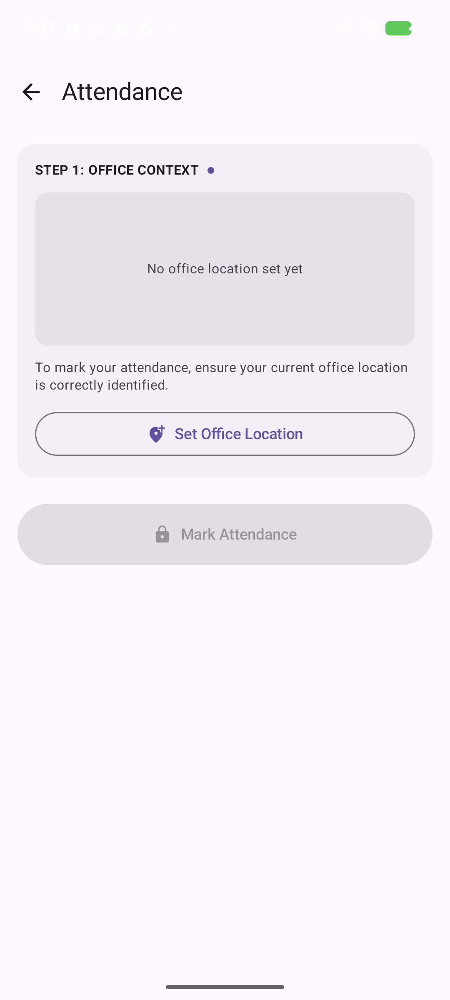
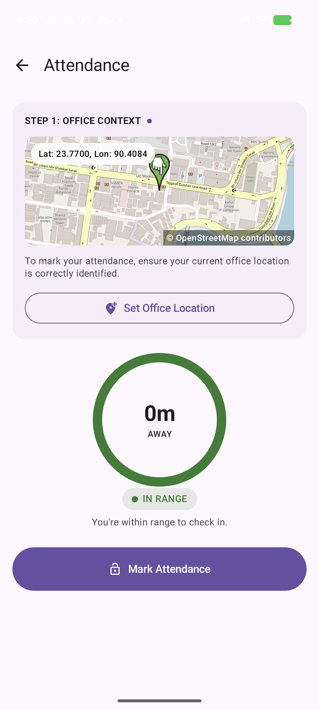
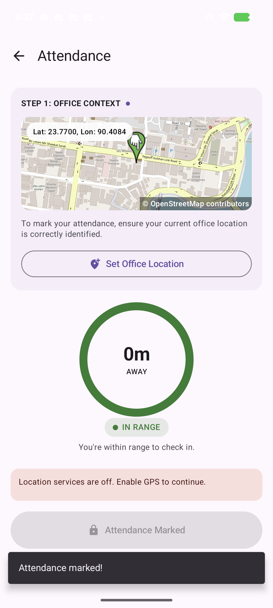
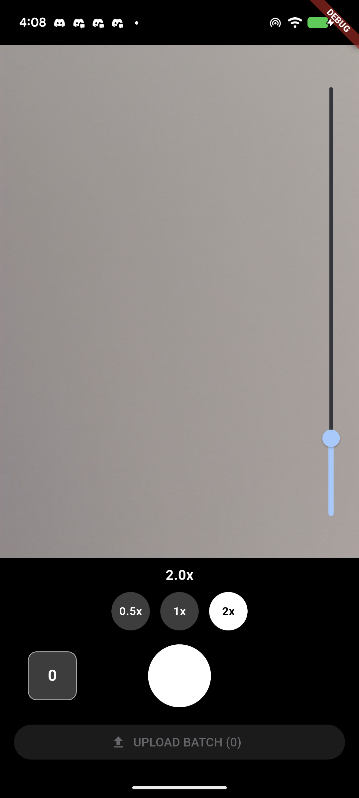
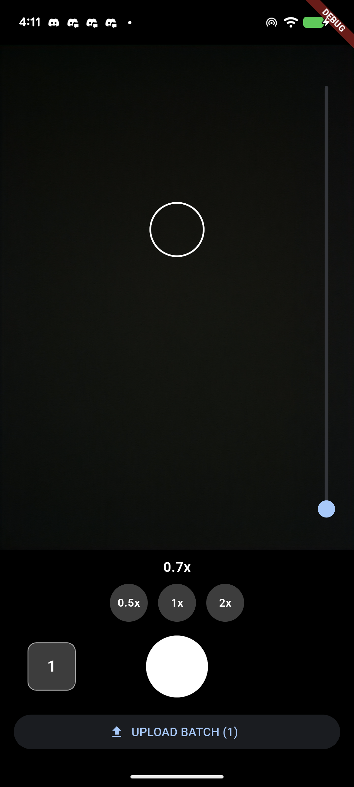
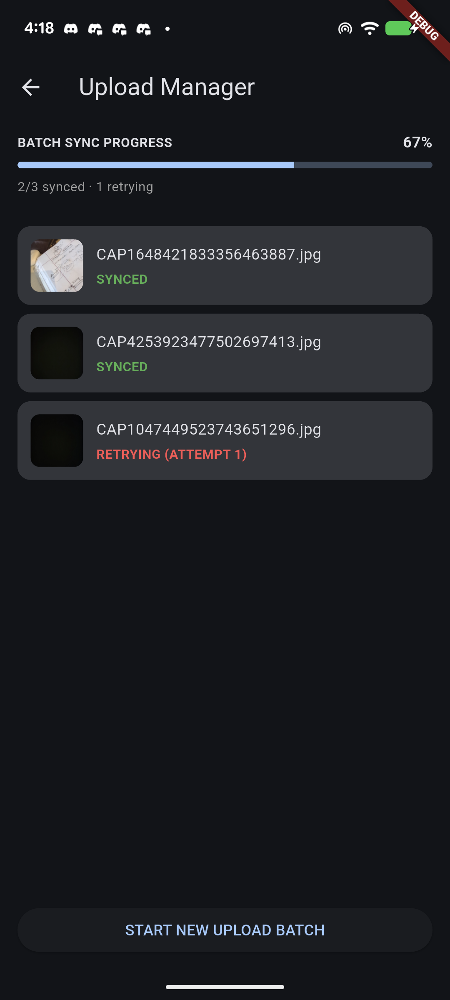
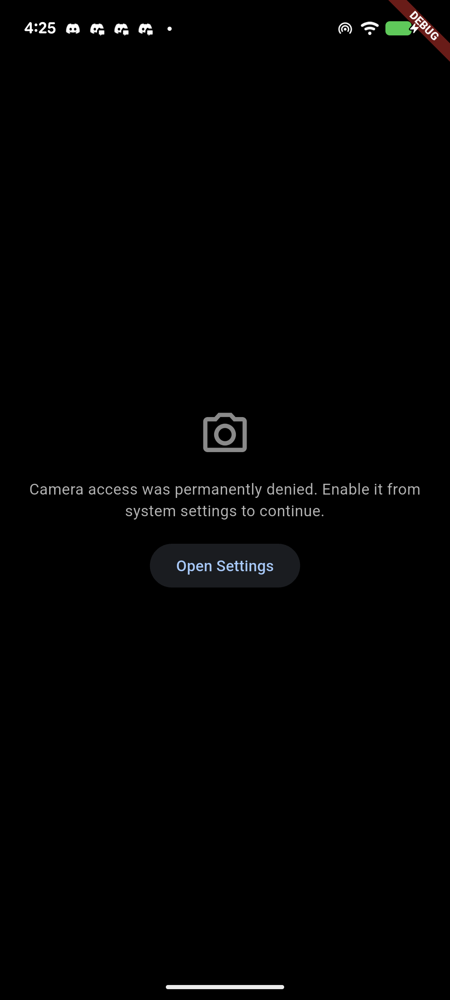

# GeoPunch

A two-part Senior App Developer technical assessment: a native Android geo-fenced attendance
system, and a Flutter camera + resilient background-sync engine.

- **Task 1 — GeoPunch Attendance** (`android-attendance/`): Jetpack Compose, Kotlin Flow / MVI.
  Lets a user set an office location, then enables a "Mark Attendance" action only while they're
  within a 50m radius, with a live distance indicator.
- **Task 2 — GeoPunch Camera Sync** (`flutter-camera-sync/`): Flutter, BLoC/Cubit, Clean
  Architecture. A custom camera screen with continuous pinch/slider/preset zoom and tap-to-focus,
  batching captured images, and a resilient upload queue that survives offline periods and retries
  automatically via `workmanager` once connectivity returns.

Both apps share the same general approach: a domain layer with no framework imports, a data layer
implementing it against real persistence (Room / Hive) and platform APIs, and a presentation layer
that only ever talks to the domain layer through its interfaces.

## Project Structure / Approach

### Task 1 — GeoPunch Attendance (`android-attendance/`)

Three Gradle modules, Clean Architecture:

- `domain/` — pure Kotlin. `Coordinates`, `AttendanceRules` (the 50m threshold) and
  `LocationResult` models; `LocationRepository`/`AttendanceRepository` interfaces; two use cases,
  `CalculateDistanceUseCase` (haversine distance) and `MarkAttendanceUseCase`.
- `data/` — `LocationDataSourceImpl` (FusedLocationProviderClient, as a Flow), a
  `LocationSettingsChecker` for the "GPS is off" banner, and `AttendanceRepositoryImpl` backed by
  Room for the saved office location and today's marked-attendance flag.
- `app/` — Jetpack Compose UI. **`AttendanceViewModel`** is the single BLoC/Cubit-equivalent class
  for this task: an MVI reducer exposing one `StateFlow<AttendanceState>` as the single source of
  truth, driven by a sealed `AttendanceIntent` (`SetOfficeLocation`, `MarkAttendance`, location
  updates). Every state transition — including the 50m in-range/out-of-range boundary — funnels
  through this one reducer, which is what makes it unit-testable as a single component
  (`AttendanceViewModelTest`). `AppContainer` wires the modules together with manual DI (no DI
  framework, given the app's size).

### Task 2 — GeoPunch Camera Sync (`flutter-camera-sync/`)

Clean Architecture mirrored from Task 1, Flutter-idiomatic BLoC/Cubit in place of MVI:

- `lib/domain/` — pure Dart, no Flutter/Hive imports. Models `CapturedImage` and `UploadBatch`;
  `UploadQueueRepository` and `UploadApi` interfaces; `CalculateBatchProgressUseCase` for the
  "N/M synced" summary.
- `lib/data/` — `HiveUploadQueueRepository` (hand-written Hive `TypeAdapter`s — see *Generative AI
  Usage* for why), `MockUploadApi` (no real backend exists for this assessment; deterministically
  fails an image's first upload attempt and succeeds on the second, so the retry story is visible
  every run instead of being randomized), `CameraControllerAdapter` wrapping the `camera` plugin,
  `UploadSyncCoordinator` (foreground-immediate attempt + a `workmanager` one-off job constrained
  on `NetworkType.connected` as the durable fallback), and the `workmanager` background callback.
- `lib/presentation/` — two Cubits:
  - **`CameraCubit`** owns zoom/focus/capture/batch state (`CameraInitializing` /
    `CameraError` / `CameraReady(zoomLevel, minZoom, maxZoom, focusPoint, batchImageCount,
    isCapturing)`). Hardware access goes through an injectable `CameraHardwareController`
    interface, so zoom clamping and batch-count logic are unit-tested without a platform channel.
  - **`UploadQueueCubit`** polls `UploadQueueRepository` on a short timer while the Upload Manager
    screen is open and emits `UploadQueueState(batches)`. It polls rather than subscribes because
    `workmanager`'s background retries run in a separate isolate with no shared memory with the UI
    isolate, so there's no push-style way to observe those writes.

## Generative AI Usage

Both tasks were built with **Claude Code**, using a structured my own workflow. 


## How to Run

### Task 1 — GeoPunch Attendance (Android)

```bash
git clone <this-repo-url>
cd android-attendance
./gradlew assembleDebug
# install app/build/outputs/apk/debug/app-debug.apk on a device/emulator, or:
./gradlew installDebug
```
Requires Android Studio / an Android SDK with API 35, a device or emulator with Google Play
services (for FusedLocationProvider), and location permission granted at runtime.

### Task 2 — GeoPunch Camera Sync (Flutter)

```bash
git clone <this-repo-url>
cd flutter-camera-sync
flutter pub get
flutter run            # debug build on a connected device/emulator
flutter test           # run the unit/widget test suite
```
Requires Flutter 3.44+ / Dart 3.12+, and a physical device or emulator with a working camera for
the camera screen (the Flutter/Dart Simulator/emulator camera is normally sufficient; a real device
is needed for zoom hardware verification). Camera permission is requested at runtime.

### Release APKs

- Task 1: `android-attendance/app/build/outputs/apk/release/app-release.apk`
- Task 2: `flutter-camera-sync/build/app/outputs/flutter-apk/app-release.apk`

(Download links: _add Google Drive / file-sharing links here before submission._)

## Screenshots

### Task 1 — GeoPunch Attendance

| Office location not set | In range, ready to mark | Attendance marked |
|---|---|---|
|  |  |  |

### Task 2 — GeoPunch Camera Sync

| 2x zoom applied | Tap-to-focus indicator | Upload Manager mid-sync | Permission denied gracefully |
|---|---|---|---|
|  |  |  |  |

All screenshots were captured on a physical Android device.
